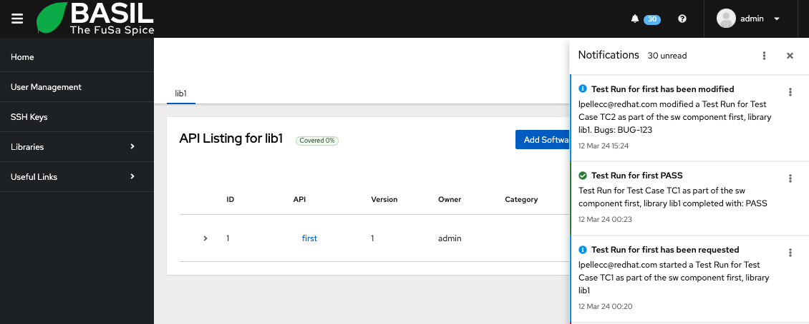

Notifications
=============

Any change to a Software Component will generate a Notification.
For example, creating a new Software Requirement, adding a Comment, running a Test Case.
To be able to be notified about such events a user should enable notifications for the desired Software Component.
Using the Software Component 3 dots menu in the page that list all the Software Components for the desired software library you can select 'Enable notification'/'Disable notification'.
If the notifications are enabled for a selected Software component you will see a Bell icon in the relative row.

To access the Notifications detail you can click on the Bell icon in the top menu, close to the avatar icon.
That will show a menu on the right side of the page with the list of all unread notifications.

From here you can set one or all the notifications as read and close the menu.

.. _mention_users_in_comments:

Mention users in comments
-------------------------

A logged-in user with role **USER** or **ADMIN** who can read a Software Component can mention a colleague from a comment on a work item.
Users with role **GUEST** can read comments on public contents. Writing a comment requires the **USER** or **ADMIN** role.

In the comment field, type ``@``.
BASIL lists up to 25 enabled **USER** and **ADMIN** accounts that can read that Software Component, other than your own.
Keep typing to filter the list by username or email, then choose a user with the mouse, Enter, or Tab.
Escape closes the list.
Arrow keys move the highlight.

The comment stores the mention and shows it as ``@username`` in the comment list and in the preview under the field.

Each user mentioned for the first time receives an in-app notification titled ``<author> mentioned you in a comment``.
The notification is delivered to that user even when they have not enabled notifications for the Software Component.
Opening it marks the notification as read, opens the mapping page, and shows the comments of that work item.

Editing a comment notifies users who are mentioned in the new text and were not mentioned before.

When a comment is added on a work item mapped directly to the Software Component, subscribers receive the usual notification that a comment was added.
The mentioned user receives the mention notification for that comment.

When ``notifications.send_email_on_tag`` is ``true`` and SMTP is configured, each newly mentioned user also receives an email.
See :ref:`settings_notifications`.

.. toctree::
   :maxdepth: 1
   :caption: Contents:
